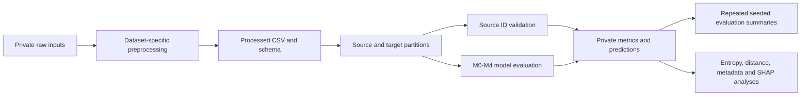

# Experimental architecture and execution guide

## Organized packages

`src/uci_transportability`, `src/abide_transportability`, and `src/tcga_transportability` come from the dataset-specific bootstrap pipelines in the original results tree. Each package retains separate `config`, `data`, `models`, `experiment`, `harmonization`, `weighting`, `transductive`, `metrics`, `reporting`, `bootstrap_reporting`, and `plots` modules. TCGA also retains `feature_selection`.



Run each preprocessing or experiment in a separate process. Legacy packages reuse generic names such as `src`, `ingestion`, and `utils`; mixing different projects within one interpreter can shadow imports. The core packages use distinct names.

## Scientific settings retained

| Setting | UCI / ABIDE core | TCGA core |
| --- | --- | --- |
| Seed | 42 | 42 |
| Target test fraction | 0.5 | 0.5 |
| Default ECE bins | 10 | 10 |
| Logistic regression | `liblinear`, max_iter 2000 | `lbfgs`, max_iter 4000, balanced class weights |
| Random forest | 500 trees | 300 trees, balanced_subsample |
| Histogram gradient boosting | learning rate 0.05, depth 4, 300 iterations | Same stated settings |
| M2 temperature / minimum weight | 0.12 / 0.25 | 0.12 / 0.25 |
| M3 target blend weight | 0.5 | 0.5 |
| Gene feature selection | Not applicable | Variance > 1e-8, top 2000 variance genes, top 500 model genes |
| ComBat gene prefilter | Not applicable | Top 500 variance genes |

Source validation uses the original grouped/site folds and original stratified fallbacks. Target training/evaluation partitions retain their existing stratification fallback rules. M2 weights are derived from source transfer comparisons. M3/M4 train a labeled adapter on the target training partition and blend probabilities with the source model. TCGA selects operating thresholds from source ID predictions, with balanced accuracy/F1 tie-breaking; UCI and ABIDE retain their configured threshold.

ComBat harmonizes training features only in these organized implementations. UCI/ABIDE preserve their feature-role inference and neuroCombat/local parametric backend selection. TCGA uses the training target covariate and its original gene-pool selection. Backend availability can affect results; installing a different backend is a methodological environment change even if the source code is identical.

ABIDE run comparisons emitted existing warnings for a missing numeric feature in some source folds and single-class predictions. These behaviors were preserved. The repository does not claim every fold is scientifically adequate or that all fallback procedures have been independently justified.

## Primary entry points

| Dataset | Single evaluation | Repeated evaluation |
| --- | --- | --- |
| UCI | `experiments/uci/bootstrap/run_m0_baseline.py` | `run_uci_bootstrap_resampling.py` in the same directory |
| ABIDE | `experiments/abide/bootstrap/run_abide_baseline.py` | `run_abide_bootstrap_resampling.py` in the same directory |
| TCGA | `experiments/tcga/bootstrap/run_tcga_baseline.py` | `run_tcga_bootstrap_resampling.py` in the same directory |

CLI method defaults differ and were preserved. UCI defaults to all five methods; ABIDE/TCGA baseline runners default to M0. TCGA `ExperimentConfig.enabled_methods` defaults to M0/M1, which is separate from its CLI default. Always state the method list for comparisons.

Example repeated evaluations with explicit input paths:

```bash
python experiments/abide/bootstrap/run_abide_bootstrap_resampling.py \
  --input results/Data/ABIDE2_preprocessing/data/processed/abide2_core_multisite_transportability_dataset_strict.csv \
  --schema configs/schemas/abide2_core_multisite_preprocessing_blueprint.json \
  --methods M0,M1,M2,M3,M4 --n-bootstrap 10 --seed 42 --seed-step 1 \
  --output-dir results/ABIDE/Methods/ABIDE2_M4_ComBat_transductive_bootstrap10_outputs

python experiments/tcga/bootstrap/run_tcga_bootstrap_resampling.py \
  --input results/Data/TCGA_BRCA_preprocessing/data/processed/tcga_brca_stage_transportability_dataset.csv \
  --methods M0,M1,M2,M3,M4 --n-bootstrap 10 --seed 42 --seed-step 1 \
  --output-dir results/TCGA/Methods/TCGA_BRCA_M4_ComBat_transductive_bootstrap10_outputs
```

TCGA supports `--target-sites`, `--skip-plots`, `--skip-report`, and batch-index options as shown by `--help`. ABIDE's core configuration supports target-site subsets, while its historical CLI does not expose that option; the archive comparison tool can select a subset programmatically.

The bootstrap runners repeatedly call the full experiment with incremented seeds. They do **not** sample patient rows with replacement. Saved aggregate variability therefore reflects repeated seeded evaluation, not a conventional patient bootstrap. Ten iterations in the commands above are an example request; full ten-iteration reruns were not performed during refactoring.

## Outputs and downstream dependencies

Each organized run writes tables, split manifests/assignments, prediction records, method diagnostics, configuration snapshots, plots and Markdown reports. Output filenames are preserved. Downstream analyses discover candidate runs using these filenames or require specific historical method folder names. Root output conventions remain `results/UCI`, `results/ABIDE`, `results/TCGA`, and `results/Data` with their historical capitalization.

Entropy, site-distance, clustered heatmap, pattern-discovery, metadata and sample-size scripts generally expose `--input-root` and `--output-dir`. They require corresponding experiment tables and often the dataset path saved in a snapshot. Some scripts search for a missing input by filename; avoid storing multiple conflicting versions under the same search root.

Metadata analyses additionally look for historical per-method tables under `Methods/`. The provided README output names follow those conventions, but not every historical prerequisite is generated by a single baseline run. SHAP scripts operate on existing meta-learning/performance tables and contain dataset-specific default roots in the path registry. Inspect their constants/input loaders and the code index before running them. A successful `--help` check does not validate those input chains.

## Preserved experimental generations

- `experiments/uci/baseline_previous`: original UCI M0 package, kept separately because it differs from the later M0–M4 implementation.
- `experiments/abide/transportability_previous`: earlier ABIDE package; its experiment orchestration differs from the bootstrap package.
- `experiments/legacy/*transductive_learning_new`: modular CORAL alignment, target pseudo-labeling, diagnostic plots and configuration variants. Their original confidence thresholds differ by dataset.
- `experiments/legacy/*transductive_learning*.py`: earlier standalone target and preprocessing variants. TCGA includes tumor/normal, 01/06 and artificial PCA/KMeans targets.
- `experiments/legacy/*weighting*` and standalone ComBat workflows: independently configured earlier weighting/harmonization experiments.
- `experiments/legacy/dashi_python_improved`: local supervised/unsupervised DASHI overrides; the matching upstream distribution/revision remains unresolved.
- `analysis/*/dashi`: dataset-specific source-map, variability and supervised characterization runners requiring the compatible DASHI API.
- `experiments/legacy/r`: R baselines, UCI merge script and report templates. R runtimes/packages were not validated.

The full index records exact duplicate snapshots redirected to canonical source files. Package-local identical files sometimes remain because flattening them would change import context; no numerically distinct implementation was dropped merely for looking similar.

Some legacy runners clear or rebuild their designated output folders. Use a dedicated `results/legacy/<experiment>` destination and keep unrelated files elsewhere. This behavior is inherited and was not removed from the scientific workflows.
